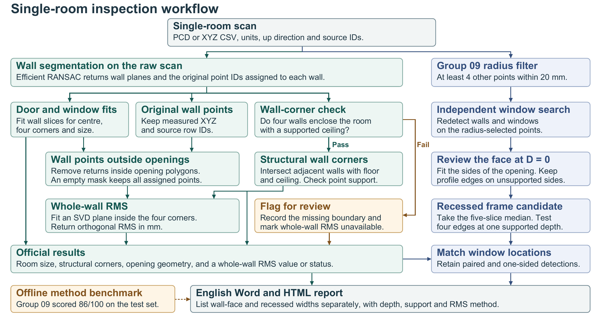

# Single-room point cloud inspection

Upload one room scan to obtain an editable English Word report. The default workflow measures the room, doors, windows and whole-wall RMS from the original point cloud. It independently redetects walls and windows on radius-selected points and reviews the four window corners with Group 09. The two branches share the uploaded source, units and up direction.

| Point cloud input | Door and window dimensions | Wall RMS |
|---|---|---|
| Official raw branch | Fit room and opening dimensions on finite original XYZ | Fit one RMS per supported wall, masking the official opening polygons |
| Group 09 review branch | Redetect openings, fit window reveals, measure the face and search for the recessed layer | The official wall values come from the raw branch |
| Optional single treatment | Select raw or radius for all primary geometry, with an optional same-input corner check | Use that single treatment's wall supports |

The Word report identifies the input treatment, the numbers of retained and finite points, and the RMS provider. Window widths appear in separate **wall-face aperture** and **recessed frame candidate** columns with depth and elevation.

The comparison page identifies each matched or single-branch window and gives measurement elevation, depth, fitted corners and support status. It distinguishes the five-slice width from the four-line fit at a single depth. The final appendix explains the [offline method score](#offline-method-benchmark).

## Read the project or reproduce the score

Clone this repository to run the inspection code. Obtain M04 and M26 from the course distribution to rerun the field measurements. The companion `Task1_Group09_Handshake.zip` contains the two saved inspections and their English Word reports.

The archived scores can be recalculated with Python 3.10 or later and the standard library. Run these commands from the repository root.

```shell
python experiments/joint_benchmark/verify_scores.py --combination 9 --mode nominal
python experiments/joint_benchmark/verify_scores.py --combination 9 --mode nominal --json
python experiments/joint_benchmark/verify_scores.py
```

The first command prints each pass or miss and the four component scores. The second returns the full trace as JSON. The third verifies the 210 published scores. A [precomputed JSON trace](validation/group09_nominal_score_trace.json) is available for readers without Python.

## Install on Windows

Use Python 3.10 or later, Node.js 18 or later, Git and MinGW g++ on PATH. Run the following in the extracted repository root. The Python adapter sources are included. The native setup retrieves the two pinned C++ sources and builds them locally.

```powershell
py -3 -m venv .venv
.\.venv\Scripts\python.exe -m pip install -r requirements.txt
.\.venv\Scripts\python.exe prepare_backends.py
.\.venv\Scripts\python.exe native_backend/scripts/fetch_native.py
.\.venv\Scripts\python.exe native_backend/native/build.py --source-root native_backend/native/sources
```

## Inspect a scan

After installation, double-click **run.cmd**, choose a scan, set units and up direction, leave **Official raw measurements + Group 09 review** selected, and click **Measure and create Word report**. The browser downloads one combined Word report. The CLI uses the same default.

```powershell
.\.venv\Scripts\python.exe inspect_room.py D:/data/M26.pcd --out results/M26_paired
.\.venv\Scripts\python.exe inspect_room.py D:/data/M26.pcd --preprocess raw --out results/M26_raw
.\.venv\Scripts\python.exe inspect_room.py D:/data/M26.pcd --preprocess radius --out results/M26_radius
.\.venv\Scripts\python.exe reporting.py results/M26_paired --out results/M26_report_copy
```

The CLI accepts PCD, CSV with x, y and z headers, and an archive member such as `scan.zip::M26.pcd`. The defaults are metres and positive Z up. Use `--unit mm` or `--up X Y Z` for other input conventions. Give each run a new output directory. To run a distributable synthetic example, use `python examples/run_demo.py --out results/demo` in the prepared environment.

<a id="四接口流程"></a>

## Measurement workflow



Efficient RANSAC supplies wall supports. Original point IDs recover the measured XYZ coordinates. The corner module checks the enclosure and ceiling before intersecting planes to locate structural corners. The opening detector fits jambs, heads and sills. The default RMS provider excludes points inside detected opening polygons, selects the remaining wall points inside the four structural corners, and fits a plane with SVD. The whole-wall RMS is the square root of the mean squared perpendicular distance, reported in millimetres. Insufficient enclosure evidence produces an unavailable wall result.

Group 09 keeps points with at least four other returns within 20 mm and independently redetects the walls and windows. It fits the opening's side planes and intersects them with the wall face to refine edges. A side with insufficient support keeps its profile edge. The recessed candidate uses the median width of five depth slices. [Editable Mermaid source](assets/group09_workflow.mmd)

## Field measurement results

On M04 and M26, the mean absolute error was **2.90 mm** for the six room dimensions and **8.22 mm** for five comparable opening readings (two door widths, two door heights, and the M26 window height). The M26 tape width was 2375 mm at an unrecorded contact depth. The official wall-face width was 2443.84 mm at D = 0, and the recessed candidate was 2378.35 mm across slices centred at D = 655–675 mm. The opening MAE excludes the tape width.

| Reference wall | Computed whole-wall RMS | Manual reference | Signed difference |
|---|---:|---:|---:|
| M04 W01 | 1.351416 mm | 1.8 mm | −0.448584 mm |
| M26 W03 | 1.142036 mm | 1.0 mm | +0.142036 mm |

All eight walls returned a whole-wall RMS. The manual measurement footprints are undocumented, so the table gives differences against the available references. [Course reference registry](references/manual_reference.json) · [Paired-run verification](validation/group09_verification.json)

## Offline method benchmark

The benchmark compares 10 preprocessing treatments × 7 window recognizers. Its four equally weighted components cover room dimensions, opening dimensions, window detection with qualifying corner errors, and wall RMS availability with a known-panel bias check. Group 09 earned **25 + 15 + 21 + 25 = 86.00** under the nominal limits (10 mm geometry and 0.50 mm panel bias), tying Group 58. At the strict limits (5 mm and 0.25 mm), they scored **80.83** and **50.83**, respectively. The score applies to the offline comparison. The default application uses Group 09 for independent window review and bases official measurements on the raw branch. [Scorecard](experiments/joint_benchmark/Combination_Scorecard.csv) · [Group 09 score trace](validation/group09_nominal_score_trace.json)

## Continue the project

- [Human handoff](TASK1_HANDOFF.md), [machine handoff](HANDSHAKE.json) and [continuation prompt](CONTINUATION_PROMPT.md)
- [Measurement and preprocessing interfaces](INTERFACE_SPEC.md), [replaceable report and RMS interfaces](REPORT_API.md)
- [Four verified production runs](validation/preprocessing_verification.json)
- [Ten-treatment experiment and P2P-Bridge diagnosis](experiments/p2p_benchmark/FINDINGS.md), [experimental code and reproduction](experiments/p2p_benchmark/README.md)
- [Algorithm contributions](CONTRIBUTIONS.md) and [native provenance and upstream usage terms](native_backend/PROVENANCE.md)
