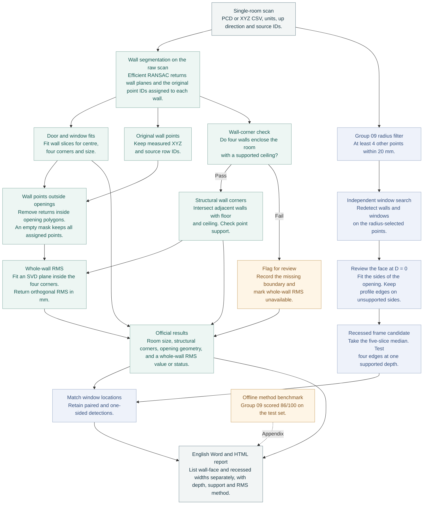

# Single-room inspection workflow

The original GitHub workflow supplies native wall supports, structural wall corners, door and window profiles, and whole-wall RMS. The released extension reads the same upload once, runs an independent radius and reveal-plane review, and publishes a combined record through the report interface. The online default branch was checked on 25 November 2026 at commit `a7edfe5d75596f72f6b060d7ff19d4e6324376e4`. [Upstream four-interface workflow](https://github.com/x13230802751/room-inspection-integrated/blob/a7edfe5d75596f72f6b060d7ff19d4e6324376e4/README.md#四接口流程)

[High-resolution figure](../assets/group09_workflow.png) · [Vector PDF for printing](../assets/group09_workflow.pdf) · [Editable Mermaid source](../assets/group09_workflow.mmd)

## How to follow the branches

The three arrows from raw wall segmentation reproduce the supplied four-interface diagram. They lead to the opening fit, the original scanner returns assigned to each wall, and the enclosure check. The opening fit supplies polygons for masking. The original returns supply the coordinates. The enclosure supplies the four-corner footprint. A failed enclosure or ceiling check goes to the report with an unavailable whole-wall RMS. The default opening search can use each detected wall's extent when structural corners are missing. Branches in the drawing describe data dependencies. In the implementation the official pass runs first, followed by the independent radius pass.

| Stage | Input, decision and output |
|---|---|
| Official raw measurements | Efficient RANSAC supplies native memberships. Original row IDs recover the scanned XYZ. The enclosure and ceiling support the four wall corners. Opening polygons mask the original points inside each four-corner footprint for whole-wall RMS. The default provider fits an SVD plane and reports the root mean squared orthogonal distance in mm. An unsupported enclosure produces an unavailable wall result. |
| Group 09 | Retain points having four other returns within an inclusive 20 mm radius and redetect the walls and windows. Fit reveal planes back to the wall face. A side with insufficient evidence inherits its profile edge. Search behind the opening for a stable paired-jamb width and test four lines in a representative slice when supported. |
| Window association | Use one-to-one spatial agreement in the original coordinate system. The released association requires projected box IoU of at least 0.50 and agreement in wall orientation, centre distance and plane offset. Keep a one-sided detection or an unavailable review in the evidence. |
| Reporting and extension | The official branch supplies door and window dimensions and the wall RMS. The report API reads saved records from both branches. It shows wall-face and recessed-candidate widths in separate columns, identifies the five-slice median and labels the single-depth fit. A profile can replace the official RMS provider or the report writer independently. |
| Offline benchmark | The 70-method benchmark uses tape dimensions, designed corners and a known-relief panel. The dashed arrow is the stored score used by the report appendix. A fresh upload has its own measurements and evidence status. P2P-Bridge and the other experimental treatments are evaluated offline. |

Read the [measurement interfaces](../INTERFACE_SPEC.md), [RMS and report contract](../REPORT_API.md) and [scoring calculation](GROUP09_SCORING.md). In the source checkout, `research/draw_integrated_workflow.py` regenerates the PDF, PNG and both Mermaid representations from the same node labels. Regenerating the figure uses ReportLab and Poppler. The prebuilt image is included in the measurement package.
